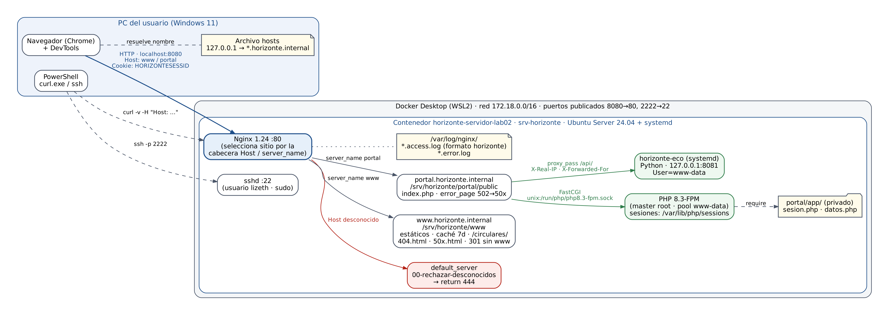

# Tecnología Web I — Servidor web Linux con hosts virtuales y backend

**Actividad 1 · Tecnología Web I (SIS-0150) · Universidad Privada Domingo Savio (UPDS)**
Docente: M.Sc. Ing. Jimmy Nataniel Requena Llorentty · Estudiante: Lizeth ________ · 2026

Servidor web Linux (Ubuntu Server 24.04) para la U.E. Horizonte, montado en **Docker** como alternativa a VirtualBox, con:

- Usuarios, grupos, permisos, paquetes y servicios administrados con `systemctl` (Lab 2).
- **Nginx** con dos hosts virtuales (`www` y `portal`), `default_server` que rechaza nombres desconocidos, redirección 301, páginas de error propias, caché y registros con tiempo de respuesta (Lab 3).
- **Backend PHP 8.3-FPM** (portal para padres con sesiones y cookies seguras) y una **API en Python** detrás de un **proxy inverso** (Lab 4).

| Laboratorio | Verificador | Documentación |
|---|---|---|
| Lab 2 — Ubuntu Server, usuarios y servicios | 14 de 14 | [docs/lab02.md](docs/lab02.md) |
| Lab 3 — Nginx con dos hosts virtuales | 14 de 14 | [docs/lab03.md](docs/lab03.md) |
| Lab 4 — PHP-FPM, proxy inverso y sesiones | 16 de 16 | [docs/lab04.md](docs/lab04.md) |

Además: [arquitectura y análisis HTTP](docs/arquitectura.md) · [bitácora de IA](BITACORA_IA.md).

## Arquitectura



## Estructura del repositorio

```
.
├── README.md
├── BITACORA_IA.md
├── docs/                  # Documentación por laboratorio, arquitectura e imágenes
├── lab02/                 # Dockerfile corregido, docker-compose.yml, preparar_servidor.sh, netplan
├── lab03/                 # Configuraciones de Nginx (www, portal, default_server, log) y sitio
└── lab04/                 # Nginx del portal (FastCGI + proxy), PHP, servicio systemd y API
```

## Cómo reproducirlo (Docker)

```powershell
# 1. Levantar el servidor (PowerShell, en lab02/alternativa_docker)
docker compose up -d --build
docker compose exec servidor bash
```

```bash
# 2. Dentro del servidor (copiar antes cada carpeta con docker cp)
bash /root/lab02/preparar_servidor.sh lizeth && bash /root/lab02/verificar_lab02.sh lizeth
bash /root/lab03/instalar_sitios.sh       && bash /root/lab03/verificar_lab03.sh
bash /root/lab04/instalar_portal.sh       && bash /root/lab04/verificar_lab04.sh
```

En Windows, agregar al archivo `C:\Windows\System32\drivers\etc\hosts` (como administrador):

```
127.0.0.1  www.horizonte.internal portal.horizonte.internal horizonte.internal
```

y abrir `http://www.horizonte.internal:8080` y `http://portal.horizonte.internal:8080` (usuario de prueba `mamani.rosa`).

| Puerto en la PC | Puerto en el servidor | Servicio |
|---|---|---|
| 8080 | 80 | Nginx (HTTP) |
| 8443 | 443 | Reservado para HTTPS (clase 5) |
| 2222 | 22 | SSH (`ssh -p 2222 lizeth@localhost`) |
