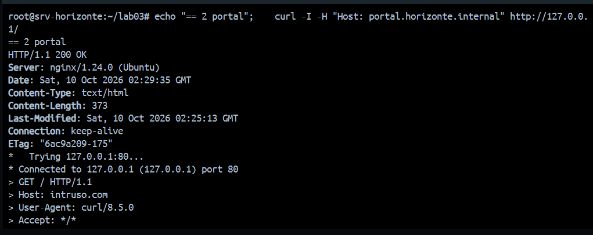

# Arquitectura cliente-servidor y análisis de peticiones HTTP

## Componentes

| Capa | Componente | Función |
|---|---|---|
| Cliente | Navegador (Chrome + DevTools), `curl.exe`, `ssh` | Envía peticiones HTTP con la cabecera `Host` y la cookie de sesión |
| Resolución | Archivo `hosts` de Windows | `127.0.0.1 → www/portal/horizonte.internal` |
| Transporte | Docker Desktop (WSL2) | Publica `8080→80` y `2222→22` hacia el contenedor (red `172.18.0.0/16`) |
| Servidor web | Nginx 1.24 | Elige el sitio por `server_name`; sirve estáticos, registra en logs y reenvía al backend |
| Backend 1 | PHP 8.3-FPM (FastCGI) | Ejecuta el portal por el socket `unix:/run/php/php8.3-fpm.sock`; sesiones en `/var/lib/php/sessions` |
| Backend 2 | `horizonte-eco` (Python, systemd) | API en `127.0.0.1:8081`, accesible solo a través del proxy `/api/` |

## Flujo de una petición al portal

1. El navegador resuelve `portal.horizonte.internal` con el archivo `hosts` → `127.0.0.1`.
2. Envía `GET / HTTP/1.1` a `localhost:8080` con `Host: portal.horizonte.internal` y la cookie `HORIZONTESESSID`.
3. Docker reenvía al puerto 80 del contenedor; Nginx compara `Host` con cada `server_name` y elige `horizonte-portal.conf`.
4. `/` → `index.php` → `location ~ \.php$` → Nginx habla **FastCGI** con PHP-FPM por el socket Unix.
5. PHP lee la sesión (`sess_<ID>`), genera el HTML y Nginx lo devuelve; la petición queda en `horizonte-portal.access.log`.
6. Si la ruta es `/api/…`, Nginx actúa como **proxy inverso** y reenvía la petición HTTP a `127.0.0.1:8081`, agregando `X-Real-IP` y `X-Forwarded-For`.

## Análisis de peticiones con curl y DevTools

| Petición | Respuesta | Qué demuestra |
|---|---|---|
| `curl -I -H "Host: www.horizonte.internal" http://127.0.0.1/` | `200 OK`, 917 bytes | Host virtual www |
| `curl -I -H "Host: portal.horizonte.internal" http://127.0.0.1/` | `200 OK`, 373 bytes (Lab 3) | Mismo IP y puerto, otro sitio |
| `curl -I -H "Host: horizonte.internal" http://127.0.0.1/inscripciones` | `301`, `Location: http://www.horizonte.internal/inscripciones` | Redirección a la dirección oficial |
| `curl -v -H "Host: intruso.com" http://127.0.0.1/` | `Empty reply from server` | `default_server` con `return 444` |
| `curl -I -H "Host: www.horizonte.internal" http://127.0.0.1/css/estilo.css` | `200`, `Cache-Control: max-age=604800` | Caché de 7 días |
| `curl -i -H "Host: portal.horizonte.internal" http://127.0.0.1/app/datos.php` | `200`, `application/octet-stream` (antes) → `404` (después) | Fuga de código y su corrección |
| `curl -H "X-Forwarded-For: 203.0.113.9" …/api/eco` | `X-Forwarded-For: 203.0.113.9, 127.0.0.1` | Cabeceras que agrega el proxy |
| DevTools → Application → Cookies | `HORIZONTESESSID`, HttpOnly ✓, SameSite Lax | Cookie de sesión segura |

