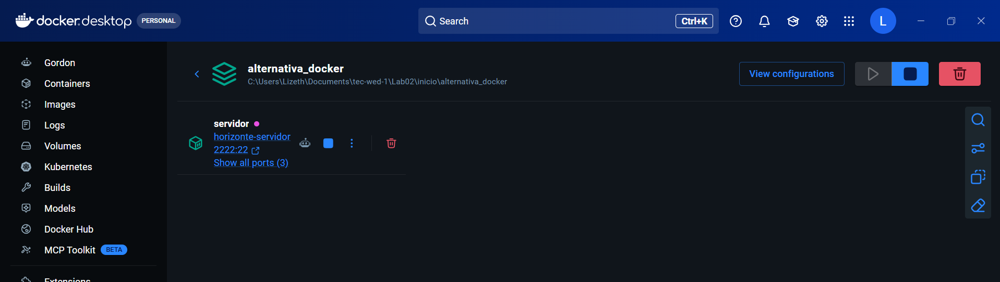
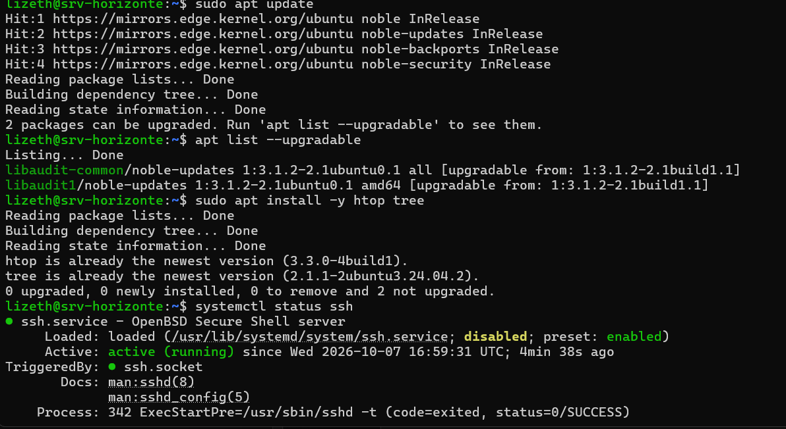
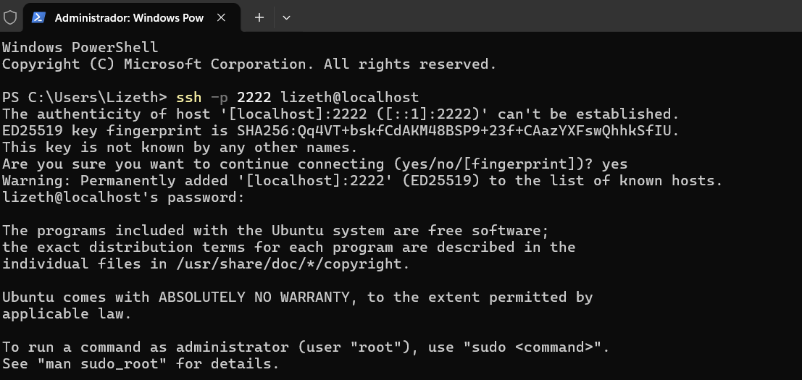

# Lab 2 — Ubuntu Server: usuarios, paquetes, red y servicios

Servidor `srv-horizonte` con Ubuntu Server 24.04.5 LTS en un contenedor Docker con systemd. Resultado: **`verificar_lab02.sh` → 14 de 14**.

## Entorno Docker

Archivos: [`lab02/alternativa_docker/`](../lab02/alternativa_docker/).

```powershell
cd lab02/alternativa_docker
docker compose up -d --build
docker compose exec servidor bash
```

**Problema resuelto:** `apt-get update` dentro de Docker devolvía `403 Forbidden` por HTTP (desde Windows funcionaba). Se aisló con pruebas (`curl.exe`, `docker run alpine wget`, otro espejo) y se solucionó usando el espejo HTTPS `mirrors.edge.kernel.org`. También se corrigió el `|| true` del Dockerfile original, que ocultaba el fallo de apt y generaba una imagen sin systemd (`/sbin/init: no such file`). Ver [`Dockerfile`](../lab02/alternativa_docker/Dockerfile) frente a [`Dockerfile.original`](../lab02/alternativa_docker/Dockerfile.original).



## Conoce tu servidor

| Comando | Resultado |
|---|---|
| `hostnamectl` | `srv-horizonte`, Ubuntu 24.04.5 LTS, kernel WSL2, virtualización `wsl`, chassis `container` |
| `ip -br a` / `ip r` | `eth0 172.18.0.2/16`, puerta de enlace `172.18.0.1` |
| `free -h` / `df -h /` | 3.7 GiB RAM; disco `overlay` 1007 G |
| `systemctl --failed` | 0 unidades con error |

## Usuarios, grupos y permisos

```bash
adduser lizeth && usermod -aG sudo lizeth
groupadd webadmin && usermod -aG webadmin lizeth
install -d -o root -g webadmin -m 2775 /srv/horizonte/www
```

`drwxrwsr-x root webadmin`: el bit **setgid** (2) hace que los archivos nuevos hereden el grupo `webadmin`; `775` = dueño rwx, grupo rwx, otros r-x.

## Servicios con systemctl

SSH estaba `active` pero `disabled` (lo arranca `ssh.socket`). Con `systemctl enable --now ssh` quedó `enabled` y `active`; `enable` crea el enlace en `multi-user.target.wants`, `start` lo inicia y `--now` hace ambos.



Acceso remoto: `ssh -p 2222 lizeth@localhost` → `sudo whoami` = `root`.



## Script idempotente

[`preparar_servidor.sh`](../lab02/preparar_servidor.sh) con los TODO completos. Ejecutado dos veces sin errores: no duplica líneas en `/etc/hosts` (`grep -c` = 2) ni el `index.html`. Clave: comprobar antes de actuar (`getent group … ||`, `[[ -f … ]] ||`, `grep -q … ||`).

## Red (VM)

[`netplan/01-horizonte.yaml`](../lab02/netplan/01-horizonte.yaml) con `192.168.56.10/24` en `enp0s8`. En Docker no aplica: se usan los puertos publicados.
