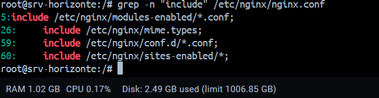
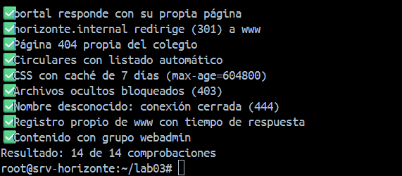
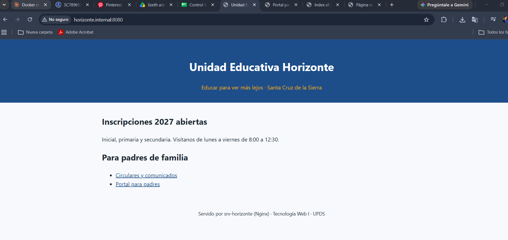
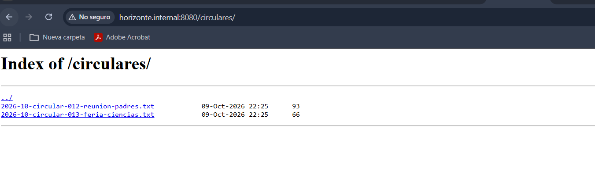
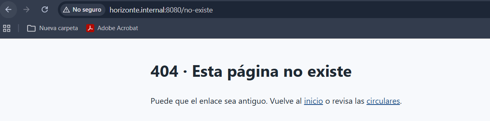
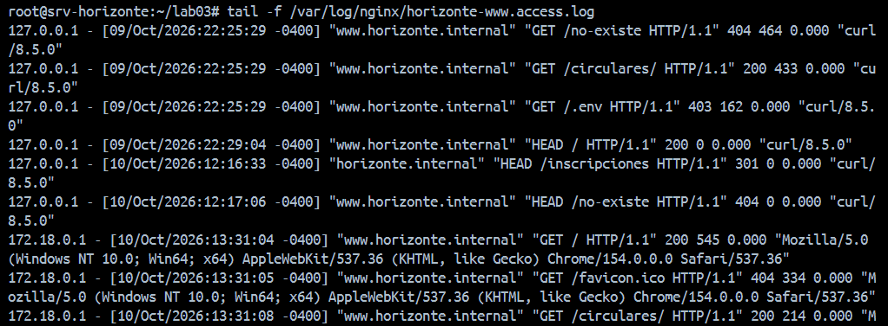
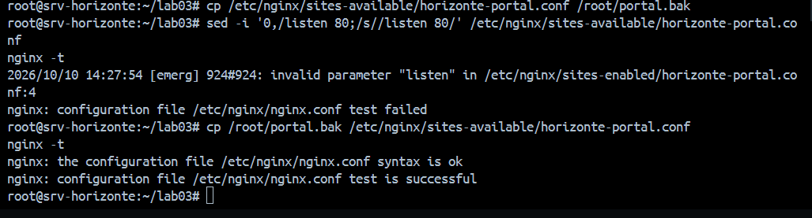

# Lab 3 — Nginx con dos hosts virtuales, errores propios, caché y registros

Resultado: **`verificar_lab03.sh` → 14 de 14**.

## Instalación y estructura

```bash
apt install -y nginx
systemctl start nginx      # en Docker, policy-rc.d impide que apt lo arranque
curl -I http://127.0.0.1/  # 200 OK, Server: nginx/1.24.0 (Ubuntu)
```

`nginx.conf` incluye `conf.d/*.conf` (línea 59) y `sites-enabled/*` (línea 60). Los sitios se escriben en `sites-available/` y se activan con un **enlace simbólico** en `sites-enabled/`: se comprobó borrando el enlace (`Failed to connect`) y recreándolo con `ln -s` (vuelve el `200 OK` con el mismo ETag).



## Configuración

| Archivo | Contenido |
|---|---|
| [`horizonte-www.conf`](../lab03/nginx/horizonte-www.conf) | `error_log … warn`, 301 de `horizonte.internal` a www, caché `expires 7d`, `/circulares/` con `autoindex`, `error_page` 404 y 50x con `internal` |
| [`horizonte-portal.conf`](../lab03/nginx/horizonte-portal.conf) | Portal escrito por la estudiante a partir del modelo de www |
| [`00-rechazar-desconocidos.conf`](../lab03/nginx/00-rechazar-desconocidos.conf) | `default_server` con `return 444` |
| [`horizonte-log.conf`](../lab03/nginx/horizonte-log.conf) | Formato `horizonte` con `$host` y `$request_time` |

```bash
bash instalar_sitios.sh && bash verificar_lab03.sh
```



## La cabecera Host

| Comando | Código | Sitio |
|---|---|---|
| `Host: www.horizonte.internal` `/` | 200 | www (917 bytes) |
| `Host: portal.horizonte.internal` `/` | 200 | portal (373 bytes) |
| `Host: horizonte.internal` `/inscripciones` | 301 | www, `Location: http://www.horizonte.internal/inscripciones` |
| `Host: intruso.com` (`curl -v`) | 444 | default_server: `Empty reply from server` |
| `Host: www…` `/no-existe` | 404 | www, `404.html` propia |
| `Host: www…` `/css/estilo.css` | 200 | www, `Cache-Control: max-age=604800` |

Una sola IP y un solo Nginx distinguen los sitios por la cabecera `Host`, comparándola con cada `server_name` (hosts virtuales basados en nombre).

## Navegador





En Docker la redirección 301 pierde el `:8080` porque Nginx no conoce el puerto externo.

## Registros y errores provocados



- Sin `;` en `listen 80;` → `[emerg] invalid parameter "listen" … horizonte-portal.conf:4` (el error real está en la línea 3).
- Sin `;` en `index index.html;` → solo `[warn] only the last index …` y `test is successful`: el portal pierde su `access_log` sin error visible.



`nginx -t` antes de `reload`: si hay error, el sitio sigue con la configuración anterior. `reload` aplica la nueva sin cortar conexiones; `restart` detiene y vuelve a iniciar el servicio.
