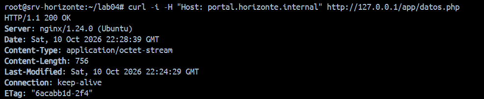
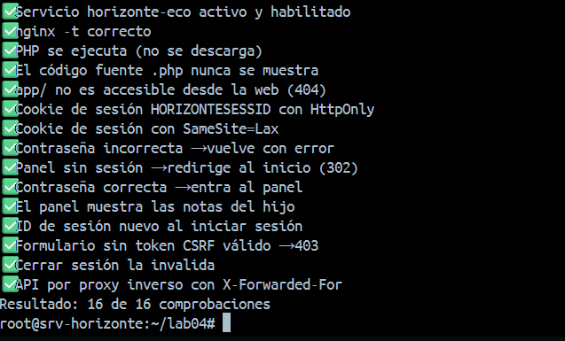
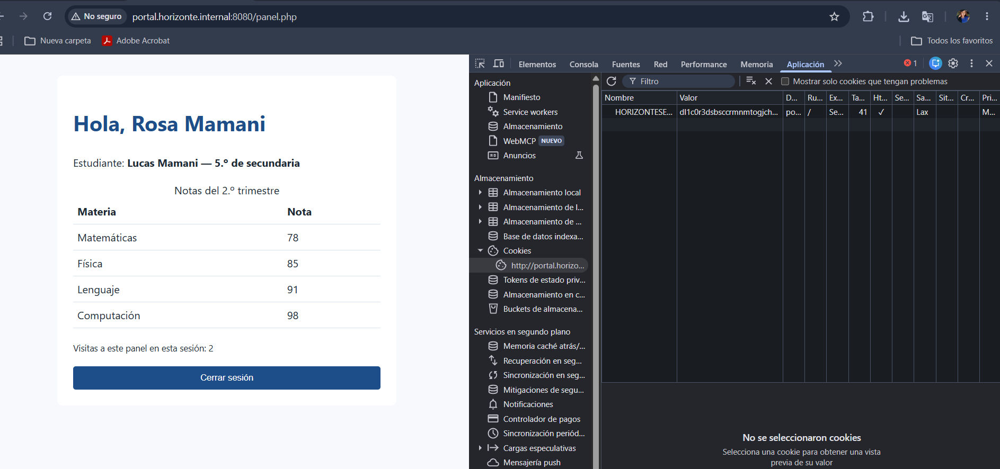
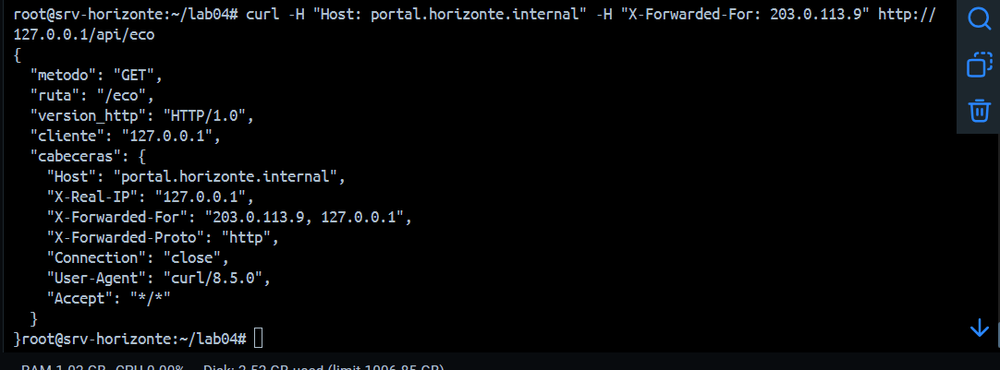
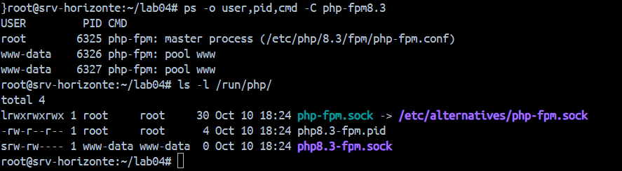
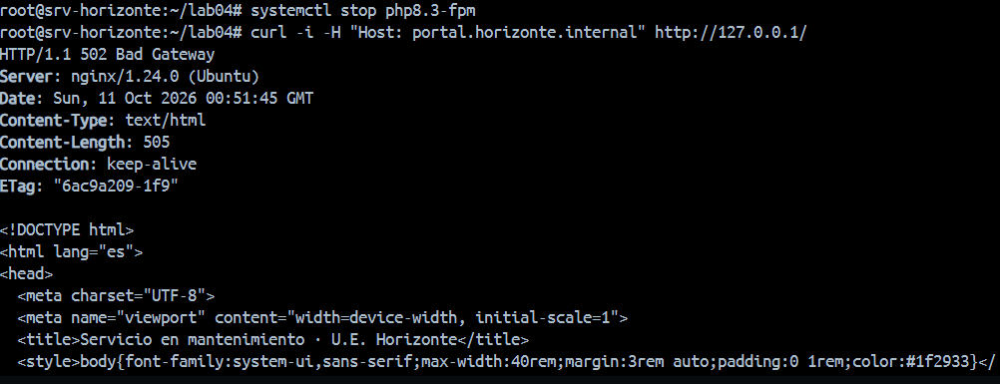
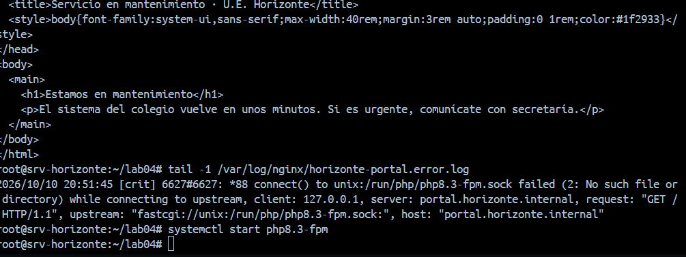
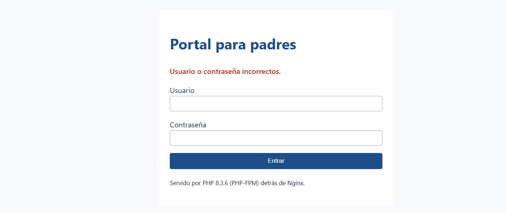

# Lab 4 — Portal para padres: PHP-FPM, proxy inverso y sesiones seguras

Resultado: **`verificar_lab04.sh` → 3 de 16 (con TODO) → 16 de 16**. Usuario de prueba: `mamani.rosa`.

## Parte A — La fuga de código

Con `root /srv/horizonte/portal` y sin `location` para `.php`:

```bash
curl -i -H "Host: portal.horizonte.internal" http://127.0.0.1/app/datos.php
# HTTP/1.1 200 OK · Content-Type: application/octet-stream · cuerpo = código PHP con datos y hash
```



## Los 10 TODO

| Archivo | Cambio |
|---|---|
| [`nginx/horizonte-portal.conf`](../lab04/nginx/horizonte-portal.conf) | `root …/public` + `index index.php`; `location ~ \.php$` con `fastcgi_pass unix:/run/php/php8.3-fpm.sock`; `location /api/` con `proxy_pass http://127.0.0.1:8081/` y 4 cabeceras; `error_page 502 503 504 /50x.html` |
| [`portal/app/sesion.php`](../lab04/portal/app/sesion.php) | `'httponly' => true`, `'samesite' => 'Lax'` |
| [`portal/public/entrar.php`](../lab04/portal/public/entrar.php) | `session_regenerate_id(true)` tras validar la contraseña |
| [`systemd/horizonte-eco.service`](../lab04/systemd/horizonte-eco.service) | `User/Group=www-data`, `ExecStart=/usr/bin/python3 /opt/horizonte/servidor_eco.py`, `Restart=on-failure`, `RestartSec=2` |



## Sesiones y cookies



- Cookie `HORIZONTESESSID`: solo un ID aleatorio; HttpOnly ✓, SameSite Lax, Secure sin marcar (aún sin HTTPS).
- `/var/lib/php/sessions/sess_<ID>` (`-rw------- www-data`): guarda el token CSRF, el usuario (login, nombre, hijo) y las visitas. El nombre está en el servidor, no en la cookie.
- Al cerrar sesión, `session_destroy()` borra el archivo.

## FastCGI y proxy inverso



`cliente = 127.0.0.1` (Nginx); `X-Forwarded-For: 203.0.113.9, 127.0.0.1` (el primer valor lo inventó el cliente, Nginx agregó el segundo). La barra final de `proxy_pass` convierte `/api/eco` en `/eco`.



Master de PHP-FPM como `root`; workers `pool www` como `www-data`. `php8.3-fpm.sock` (`srw-rw----`) es el socket Unix de FastCGI.

## 502 Bad Gateway




| Backend detenido | Mensaje en `horizonte-portal.error.log` |
|---|---|
| `php8.3-fpm` | `[crit] connect() to unix:/run/php/php8.3-fpm.sock failed (2: No such file or directory)` |
| `horizonte-eco` | `[error] connect() failed (111: Connection refused) … upstream: "http://127.0.0.1:8081/eco"` |
| Contraseña incorrecta | `FastCGI sent in stderr: "PHP message: portal: acceso fallido para 'mamani.rosa' desde 172.18.0.1"` |



## Reflexión

FastCGI pasa un script a un intérprete (PHP-FPM) por un socket; el proxy inverso reenvía la petición HTTP completa a otro servidor (la API), por eso necesita `X-Forwarded-For`. El código va fuera de la carpeta pública porque todo lo que está bajo `root` puede pedirse por URL, como demostró la Parte A.
